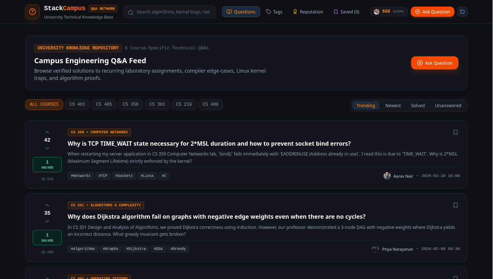

# StackOverflow Campus — University Technical Knowledge Network

> High-velocity campus developer knowledge base, in-browser fuzzy search engine, course-specific Q&A threads, and peer reputation system.



## Overview

University engineering students repeatedly encounter similar lab challenges, compiler edge-cases, system call traps, and algorithmic bottlenecks across departmental coursework (Operating Systems, Compilers, Distributed Systems, Computer Networks, DBMS, and DSA). Solutions traditionally remain scattered across ephemeral group chats or personal notes.

**StackOverflow Campus** provides an institutional technical knowledge network organized directly around university course curricula, lab problem sets, and code verification, powered by client-side fuzzy search and peer reputation scoring.

---

## Key Features

- **Course-Centric Knowledge Graph**:
  - Filter questions by formal course codes: `CS 401` (OS), `CS 405` (Compilers), `CS 350` (Networks), `CS 301` (Algorithms), `CS 210` (DBMS), and `CS 480` (Machine Learning).
- **Fuzzy Search Engine (Fuse.js)**:
  - Fast client-side search across question titles, body excerpts, and tags with typo tolerance.
- **Rich Q&A Threads & Markdown Code Snippets**:
  - Code blocks in C, C++, Rust, Python, Assembly, and SQL.
  - Upvote and downvote mechanics on questions and answers.
  - Verified Accepted Solutions with distinct green border and author attribution.
- **Peer Reputation Engine**:
  - Dynamic karma computation:
    - Base reputation: $100$
    - Question Upvote: $+5$
    - Answer Upvote: $+10$
    - Accepted Solution Bonus: $+15$
- **Campus Leaderboard & Badges**:
  - Real-time ranking of top engineering contributors with tiered badges (*Kernel Wizard*, *Tensor Titan*, *Packet Whisperer*, *Buffer Overflow Hunter*).
- **Taxonomy Tag Explorer**:
  - Tag index with live question frequency counters (`#Linux`, `#IPC`, `#Compilers`, `#Dijkstra`, `#PyTorch`, `#TCP`).
- **Personal Bookmarks**:
  - Save critical solutions locally for quick offline reference during exam preparation and lab vivas.
- **Local Persistence & Reset**:
  - All questions, votes, answers, and bookmarks persist in browser `localStorage` with a 1-click reset-demo-data option.

---

## Technical Stack

| Layer | Technology |
|---|---|
| Framework | React 19 + TypeScript |
| Build System | Vite |
| Styling | Tailwind CSS v4 |
| State Management | Zustand with Local Storage Persistence |
| Search Engine | Fuse.js Client-Side Fuzzy Search |
| Icons | Lucide React |
| Testing | Vitest |

---

## Getting Started

### Prerequisites

- Node.js $\ge 18$
- pnpm $\ge 8$

### Installation & Run

```bash
# Clone the repository
git clone git@github.com:Sanyam-Ahuja/stackoverflow-campus.git
cd stackoverflow-campus

# Install dependencies
pnpm install

# Start development server
pnpm dev

# Run Vitest test suite
pnpm test

# Build for production
pnpm build
```

---

## License

MIT © 2026 StackOverflow Campus. Built for Smart Campus & Student Life Portfolio.
